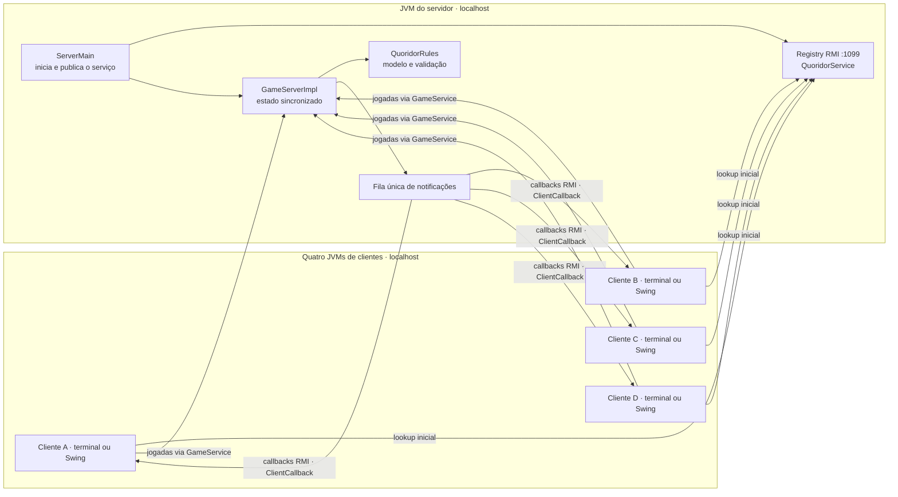
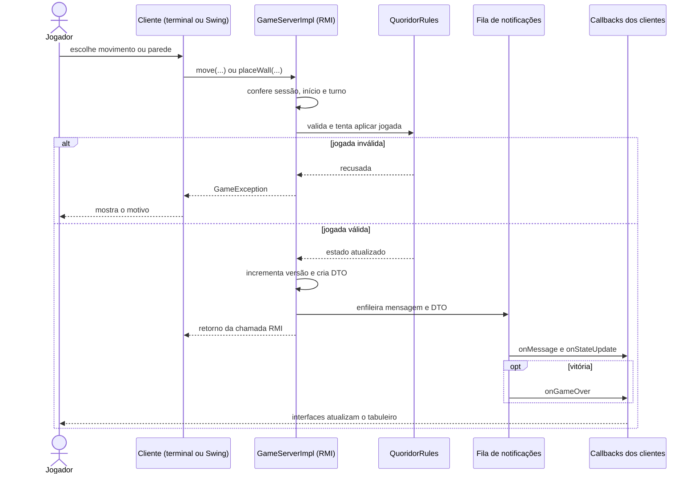
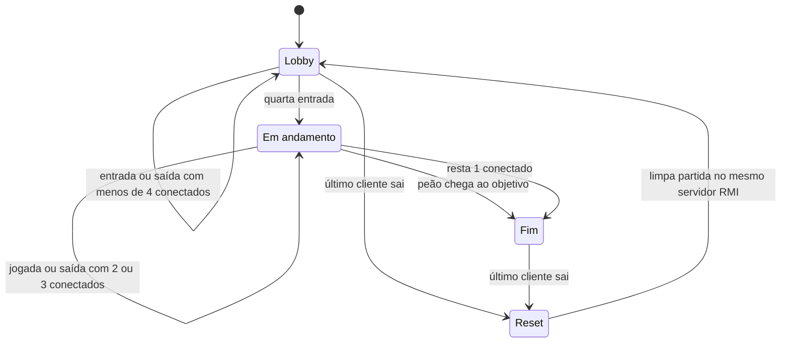

# Quoridor distribuído para 4 jogadores

- **Aluno:** Gabriel Rosa Galdino
- **Matrícula:** 202320098
- **Disciplina:** Sistemas Distribuídos

Trabalho de Sistemas Distribuídos com servidor Java RMI e clientes de terminal ou Swing. O motor de regras, os contratos compartilhados e os dois clientes estão implementados e testados. A partida usa um servidor e quatro clientes em cinco processos Java separados; os dois tipos de cliente podem jogar juntos.

## Compilar no Terminal

Instale um **JDK 17 ou superior** e o **Maven**. Confira se `java`, `javac` e `mvn` funcionam no terminal. Abra um terminal na raiz do projeto e execute o mesmo comando no Windows, Linux ou macOS:

```text
mvn clean package
```

O Maven compila, roda os testes e cria `target/quoridor-distribuido-0.1.0-SNAPSHOT.jar`. Na primeira execução, ele precisa baixar os plugins e o JUnit. Deixe a porta **1099** livre durante a compilação, pois os testes de integração iniciam um servidor RMI local. Se alterar o código depois, compile novamente antes de jogar.

## Jogar pelo terminal

Após compilar, abra **cinco terminais** na raiz do projeto. No primeiro, inicie o servidor e deixe-o aberto:

```text
java -cp target/quoridor-distribuido-0.1.0-SNAPSHOT.jar server.ServerMain
```

Em **cada um** dos outros quatro terminais, inicie um cliente:

```text
java -cp target/quoridor-distribuido-0.1.0-SNAPSHOT.jar client.ClientMain
```

Cada cliente pede o nome do jogador no próprio terminal. A partida começa quando o quarto jogador entra. Digite `q` para sair de um cliente e use Ctrl+C no terminal do servidor para encerrá-lo. Os comandos de jogada estão na seção [Comandos do cliente de terminal](#comandos-do-cliente-de-terminal).

## Jogar em modo gráfico

Após compilar, abra **cinco terminais** na raiz do projeto. No primeiro, inicie o servidor e deixe-o aberto:

```text
java -cp target/quoridor-distribuido-0.1.0-SNAPSHOT.jar server.ServerMain
```

Em **cada um** dos outros quatro terminais, execute o cliente gráfico. Cada comando abre uma janela Swing para um jogador:

```text
java -cp target/quoridor-distribuido-0.1.0-SNAPSHOT.jar client.gui.GuiClientMain
```

Na janela de cada cliente, informe o nome e mantenha o host `localhost`. A partida começa quando o quarto jogador entra. Para sair, use “Sair da partida” ou feche a janela; Ctrl+C encerra o servidor. O modo gráfico precisa de um ambiente de desktop. Veja os controles em [Cliente gráfico Swing](#cliente-gráfico-swing).

Os comandos são iguais no Windows, Linux e macOS. Os dois modos usam o **mesmo servidor** e podem ser combinados: por exemplo, dois clientes de terminal e dois gráficos. O total continua sendo quatro clientes, cada um em seu processo. Após todos os clientes saírem, o servidor volta ao lobby e aceita outra partida sem reiniciar. O JAR não possui manifesto para `java -jar`; por isso os comandos informam a classe principal.

## Tecnologias e requisitos

- Java 17 ou superior e Maven.
- Nenhuma dependência externa da aplicação: apenas o JDK. JUnit 5 é uma dependência exclusiva de testes; os plugins Maven são ferramentas de build.
- Cinco processos separados: um servidor e quatro clientes, um por jogador, com interface de terminal ou Swing.
- Todos os processos na mesma máquina, usando `localhost`.
- Toda a comunicação entre processos via Java RMI, incluindo callbacks do servidor para os clientes.
- É proibido usar diretamente `java.net.Socket` ou `java.net.ServerSocket` no código da aplicação.

## Estrutura

```text
pom.xml
APRESENTACAO.md
src/main/java/
├── model/
│   ├── Board.java
│   ├── Player.java
│   ├── Position.java
│   ├── Wall.java
│   ├── GameState.java
│   └── QuoridorRules.java
├── common/
│   ├── GameService.java
│   ├── ClientCallback.java
│   ├── GameException.java
│   ├── GameStateDTO.java
│   └── WallOrientation.java
├── server/
│   ├── ServerMain.java
│   └── GameServerImpl.java
└── client/
    ├── ClientMain.java
    ├── ClientCallbackImpl.java
    ├── TerminalCommand.java
    ├── TerminalUI.java
    └── gui/ (cliente Swing, sessão, callbacks e dicas visuais)

src/test/java/ (regras, servidor, terminal, integração entre processos e Swing)
```

| Pacote | Responsabilidade |
| --- | --- |
| `model` | Estado e regras puras, sem RMI ou interface. |
| `common` | Interfaces remotas e DTOs serializáveis compartilhados. |
| `server` | Registry, partida autoritativa, validação e notificações. |
| `client` | Conexão, exportação do callback e interface de terminal. |
| `client.gui` | Interface Swing e dicas calculadas a partir do DTO; o servidor continua decidindo as jogadas. |

## Arquitetura



O Registry está dentro da JVM do servidor. Cada cliente consulta `QuoridorService` para obter o stub; depois, as jogadas vão diretamente ao serviço remoto. Cada cliente exporta seu callback e passa o stub dele ao servidor em `join`. O servidor envia notificações diretamente aos callbacks dos clientes. A porta 1099 é a do Registry; o RMI escolhe as portas dos objetos exportados. No terminal, o callback entrega eventos à fila da `TerminalUI`; no Swing, entrega eventos à thread de interface.

## Fluxo de uma jogada



1. O cliente converte a ação em um destino ou em uma parede. No terminal, `TerminalUI.handleCommand` interpreta `m s` como o destino `(1,4)` para o jogador A na posição inicial; no Swing, o jogador pode clicar na casa destacada.
2. O cliente chama `GameService.move(0,1,4)` no stub. O RMI transporta a invocação até `GameServerImpl.move`.
3. Sob `synchronized`, `requireTurn` verifica registro, início da partida, vencedor e turno. `QuoridorRules.tryMove` verifica paredes, ocupação e regras de movimento.
4. Se houver recusa, o servidor lança `GameException`; o cliente apresenta a mensagem e permite corrigir o comando. Nada é alterado no estado oficial.
5. Se a jogada for aceita, o servidor altera o estado, avança o turno ou detecta vitória, incrementa a versão e captura um `GameStateDTO` imutável.
6. `publish` enfileira as notificações. A chamada remota retorna sem esperar a entrega de todos os callbacks.
7. Fora do monitor do estado, a fila chama `onMessage` e `onStateUpdate` nos stubs de callback dos jogadores conectados; após uma vitória, também chama `onGameOver`.
8. O cliente de terminal coloca os eventos em sua fila; o Swing os entrega à thread de interface. Ambos atualizam o tabuleiro com o DTO. Uma falha de callback faz o servidor desconectar aquele jogador e publicar a nova situação.

Pedidos de parede seguem o mesmo fluxo, usando `placeWall` e `QuoridorRules.tryPlaceWall`, com verificação de sobreposição, cruzamento, inventário e BFS para os quatro objetivos.

O retorno da chamada RMI e a entrega dos callbacks são assíncronos entre si: uma atualização pode chegar ao cliente antes do retorno da jogada.

## Motor de regras implementado

O tabuleiro tem 9x9 casas. As coordenadas são `(linha, coluna)`, de 0 a 8; a linha 0 fica ao norte. Os IDs e a ordem fixa de turnos são: 0 norte, 1 sul, 2 leste, 3 oeste. Cada jogador começa no centro do seu lado com cinco paredes e vence ao atingir qualquer casa do lado oposto.

`QuoridorRules` mantém uma partida. Pedidos inválidos retornam `false` sem consumir turno, parede ou alterar o estado. Uma jogada válida consome o turno; após a vitória, novos movimentos e paredes são recusados.

| Método | Uso |
| --- | --- |
| `tryMove(playerId, row, column)` | Pede um movimento para uma casa absoluta. |
| `tryPlaceWall(playerId, row, column, orientation)` | Pede uma parede horizontal ou vertical. |
| `currentPlayer()` | Retorna o jogador da vez; `null` se todos estiverem desconectados. |
| `getWinner()` | Retorna o vencedor, ou `null` enquanto não houver vencedor. |
| `markDisconnected(playerId)` | Desconecta um jogador, preserva seu peão e pula seus turnos. |
| `getState()` | Permite consultar jogadores e paredes, sem mutação pela API pública. |
| `renderAscii()` | Produz o tabuleiro e a situação em texto; peões 1 a 4 correspondem aos IDs 0 a 3. |

As paredes usam uma interseção `(linha, coluna)` de 0 a 7. Uma parede `HORIZONTAL` em `(r,c)` bloqueia as passagens de `(r,c)` para `(r+1,c)` e de `(r,c+1)` para `(r+1,c+1)`. Uma `VERTICAL` bloqueia `(r,c)` para `(r,c+1)` e `(r+1,c)` para `(r+1,c+1)`. Pontas podem se tocar; sobreposição de segmentos e cruzamento na mesma interseção são proibidos.

O movimento normal é ortogonal. Um peão adjacente pode ser saltado se ambas as passagens estiverem livres. Se parede, borda ou outro peão impedir a chegada atrás dele, o motor permite contorná-lo diagonalmente pelas laterais livres, sem saltar uma cadeia de peões. Uma parede entre os dois peões impede o salto. Peões desconectados continuam ocupando suas casas.

Antes de aceitar uma parede, o motor executa uma BFS para cada um dos quatro jogadores, incluindo os desconectados. Essa busca verifica caminhos pelas passagens do tabuleiro e ignora peões; testa a parede candidata sem modificar o estado. A parede e seu custo só são aplicados se todos ainda puderem alcançar seu objetivo.

Referência das regras de base: [manual oficial da Gigamic](https://export.gigamic.com/wp-content/uploads/2021/01/INS-RULES-QUORIDOR_10-2016.pdf). O tratamento de outro peão atrás como impedimento para salto reto segue o requisito deste trabalho.

```java
QuoridorRules game = new QuoridorRules();
boolean accepted = game.tryMove(0, 1, 4);
System.out.println(game.renderAscii());
```

O exemplo pressupõe `import model.QuoridorRules;`. O motor não usa RMI e não é responsável por sincronizar chamadas concorrentes: o servidor controla esse acesso.

## Servidor RMI

`ServerMain` cria o Registry embutido com `LocateRegistry.createRegistry(1099)`, exporta o serviço remoto e o registra como `QuoridorService`. Não é necessário iniciar `rmiregistry` separadamente. A porta 1099 pertence ao Registry; os objetos remotos têm suas portas de exportação gerenciadas pelo RMI.

Cada cliente é iniciado em sua própria JVM, consulta o Registry em `localhost:1099`, exporta um objeto que implementa `ClientCallback` e envia seu stub ao servidor no registro do jogador. O servidor armazena essas referências para enviar atualizações por callback RMI. O quarto registro inicia automaticamente a partida.

| Operação de `GameService` | Comportamento |
| --- | --- |
| `join(nome, callback)` | Retorna ID de 0 a 3. Exige nome válido e callback; a quarta entrada inicia o jogo. |
| `move(playerId, linha, coluna)` | Valida um destino absoluto de 0 a 8, incluindo saltos. |
| `placeWall(playerId, linha, coluna, orientation)` | Valida uma parede em interseção de 0 a 7, com `WallOrientation`. |
| `leave(playerId)` | Libera a vaga antes do início; durante a partida, desconecta e preserva o peão. |

Todas as operações declaram `RemoteException` para falhas de comunicação e `GameException` para recusas do jogo. Uma recusa traz uma mensagem clara em português e não altera o turno nem os recursos. Depois do início, não há reposição de jogadores nessa partida. Após a vitória, jogadas são recusadas; novas entradas ficam disponíveis quando todos saem e o servidor volta ao lobby.

### Ciclo de vida: lobby → em andamento → fim → reset



- **Lobby:** a partida só começa com exatamente quatro jogadores registrados. Enquanto o lobby permanece aberto, cada entrada ou saída notifica os conectados com `Aguardando jogadores (N/4)` e um DTO atualizado. Terminal e Swing mostram a contagem e bloqueiam pedidos de jogada até o início; o servidor também os recusa. Uma saída no lobby libera a vaga e conserva a relação ID/cor/lado para o substituto. O quinto jogador recebe `Partida cheia`.
- **Em andamento:** com dois ou três conectados, o jogo continua. Os turnos dos desconectados são pulados e seus peões permanecem como obstáculos. Se o jogador da vez sair ou falhar em um callback, o turno passa imediatamente ao próximo conectado.
- **Fim:** vence quem chega ao objetivo ou o único conectado restante. Na vitória por desconexão, o servidor envia o motivo `demais jogadores desconectaram` por `onMessage`, o DTO final com `winnerId` e turno nulo, e `onGameOver(id)`. As assinaturas remotas não foram alteradas. Uma vitória já declarada não é substituída por saídas posteriores.
- **Reset:** ao chegar a zero conectados, seja por `leave` ou falhas de callback, o servidor descarta o motor anterior e limpa sessões, nomes e vencedor. O tabuleiro, inventários e turnos voltam ao estado inicial; novos jogadores recebem novamente IDs de 0 a 3. Isso vale para lobby vazio e partidas terminadas, inclusive por chegada ao objetivo. Registry e serviço permanecem publicados.

Entradas, saídas, vitória e reset usam o mesmo monitor `synchronized` das jogadas. O vencedor por desconexão é parte do ciclo de vida do servidor; o motor de regras do tabuleiro continua inalterado. A versão dos DTOs cresce durante toda a execução do serviço, inclusive entre partidas. A fila confere a identidade da sessão antes de notificar ou tratar uma falha, impedindo que callbacks antigos afetem os novos ocupantes dos mesmos IDs. Callbacks continuam fora do monitor.

O servidor confere registro, início da partida, vencedor e turno antes de usar o motor de regras. Seus métodos remotos são `synchronized` e protegem todo o estado da partida. As notificações usam uma fila única e ocorrem fora do monitor, preservando a ordem dos eventos sem manter o estado bloqueado durante uma chamada remota.

`ClientCallback` define `onMessage(String)`, `onGameStarted()`, `onStateUpdate(GameStateDTO)` e `onGameOver(int vencedor)`. O vencedor é um ID de 0 a 3. O servidor envia a atualização final antes do aviso de vitória. Callbacks são assíncronos em relação ao retorno dos pedidos; o cliente deverá coordená-los com a leitura do teclado e aceitar que uma notificação possa chegar antes do retorno de `join`.

Se qualquer callback lançar `RemoteException`, o servidor registra o erro, desconecta aquele jogador e publica uma nova atualização aos demais. Durante a partida, o motor pula seus turnos e mantém o peão como obstáculo. Antes do início, a vaga fica disponível para outro cliente. Também são tratadas falhas de execução lançadas pelo callback. A detecção ocorre ao tentar notificar o cliente; não existe monitor periódico nesta versão.

`GameStateDTO` é serializável e imutável, com versão, tamanho do tabuleiro, indicação de início, turno, vencedor, jogadores e paredes. Cada jogador inclui ID, nome, lado, posição, paredes restantes e flags de entrada e conexão. Os DTOs não dependem de `model`; o estado interno nunca é enviado diretamente. O turno do DTO é `null` antes do início, após a vitória ou quando não há jogadores conectados.

O console registra entradas, início, movimentos, paredes, recusas, falhas de callback, desconexões, vitória e encerramento.

## Cliente gráfico Swing

Depois de abrir o cliente gráfico pelo passo a passo no início do README, use a janela para acompanhar o tabuleiro e enviar jogadas. O host padrão do Registry é `localhost`.

O painel desenha as 81 casas, os peões A–D em azul, vermelho, verde e roxo, as paredes e os quatro lados de objetivo em tons suaves. O painel lateral mostra nomes, cores, inventário, turno e mensagens. Um peão desconectado permanece no tabuleiro, marcado com um X.

- **Movimento:** na sua vez, as casas possíveis ficam destacadas. Clique em uma delas, inclusive para saltos diagonais. As setas fazem movimentos ortogonais ou saltos retos.
- **Parede:** ative “Modo parede”, escolha horizontal ou vertical e passe o mouse sobre uma borda interna. A prévia fica verde quando permitida pelo estado recebido e vermelha em caso de sobreposição, cruzamento, falta de paredes ou bloqueio de caminho. Clique na prévia verde para enviar o pedido.
- **Turno:** os controles são desabilitados fora da sua vez e durante um pedido pendente. Ao fim da partida, um diálogo apresenta o vencedor.
- **Saída:** use “Sair da partida” ou feche a janela; a sessão avisa `leave` em segundo plano e remove a exportação do callback.

`BoardHints` calcula apenas dicas visuais a partir do DTO, incluindo BFS para a prévia de paredes. Não altera o motor de regras nem aceita jogadas. Mesmo uma prévia verde depende da validação final do servidor, e uma recusa aparece no log sem encerrar o cliente.

`GuiCallback` implementa o contrato `common.ClientCallback` e entrega **todos** os callbacks com `SwingUtilities.invokeLater`. `GameWindow` usa `SwingWorker` para conexão, jogadas e saída; `GuiSession` impede chamadas RMI na EDT. Nenhuma biblioteca externa foi adicionada. Terminal e Swing compartilham os contratos originais, exibem o lobby com contagem e respeitam o ciclo de vida do servidor.

Os testes do novo pacote verificam movimentos e BFS das dicas, entrada por mouse e setas, pintura em memória, entrega de callbacks na EDT e quatro sessões conectadas ao servidor existente. A imagem `target/gui-board-preview.png` é produzida pelo teste de pintura para inspeção visual.

## Comandos do cliente de terminal

Os símbolos são fixos: `A` norte (ID 0), `B` sul (ID 1), `C` leste (ID 2) e `D` oeste (ID 3). Não é necessário suporte a cores ou códigos ANSI. Cada atualização mostra o tabuleiro completo, nomes, quantidades de paredes, desconexões, jogador da vez e vencedor. `-` representa parede horizontal; `|` representa parede vertical. As coordenadas das casas e interseções seguem a convenção descrita no motor.

| Comando | Pedido |
| --- | --- |
| `m w` | Mover para o norte (linha diminui). |
| `m a` | Mover para o oeste (coluna diminui). |
| `m s` | Mover para o sul (linha aumenta). |
| `m d` | Mover para o leste (coluna aumenta). |
| `p L C h` | Colocar parede horizontal na interseção `(L,C)`, de 0 a 7. |
| `p L C v` | Colocar parede vertical na interseção `(L,C)`, de 0 a 7. |
| `m wa`, `m wd`, `m sa`, `m sd` | Escolher destino diagonal: noroeste, nordeste, sudoeste ou sudeste. |
| `q` | Sair a qualquer momento, inclusive no turno de outro jogador. |

Por exemplo, `p 3 0 h` pede uma parede horizontal em `(3,0)`. Se uma direção simples apontar para um peão adjacente, o cliente pede a casa atrás desse peão, permitindo o salto reto. Se o salto reto estiver impedido, use uma das direções diagonais para escolher a lateral. O cliente apenas converte essas intenções em destinos; o servidor valida paredes, ocupação, saltos e turnos.

Os pedidos de jogada são enviados quando o último estado recebido indica sua vez. Após um pedido aceito, o cliente aguarda a próxima atualização antes de permitir outro. Se o estado ficar desatualizado, a validação final continua sendo do servidor. Comandos malformados e recusas do servidor mostram uma mensagem e permitem tentar novamente. Falhas de comunicação também são apresentadas sem encerrar automaticamente o terminal.

O callback apenas coloca eventos em uma fila. Um único laço imprime mensagens e atualizações, enquanto uma thread daemon lê o teclado. Isso permite redesenhar o tabuleiro mesmo durante a espera por um comando, sem bloquear callbacks e sem executar regras localmente. Atualizações com versão antiga são descartadas.

Após a vitória, o vencedor aparece com símbolo e nome, e novos comandos de jogada são recusados. Digite `q` para encerrar. `q`, fechamento da entrada e Ctrl+C tentam avisar `leave` ao servidor e removem a exportação do callback.

As regras de ciclo de vida também valem para o **cliente de terminal**: com um, dois ou três jogadores, ele mostra `Aguardando jogadores (N/4)` e bloqueia movimentos e paredes; um quinto cliente recebe a recusa do servidor. Se os demais desconectarem, o último jogador vê o motivo, o vencedor e `Você venceu!`. Depois que todos digitarem `q`, o servidor volta ao lobby limpo. Execute novamente o comando de `client.ClientMain` para a próxima partida, mantendo o mesmo servidor em execução.

O teste `terminalClientsRespectLobbyLastPlayerVictoryAndReset` inicia clientes de terminal em JVMs separadas, verifica essas transições e executa uma segunda partida no mesmo processo servidor.

## Testes

Para executar somente os testes:

```text
mvn test
```

Os testes cobrem as regras do modelo, o serviço e o cliente: início automático, recusas, snapshots serializáveis, desconexões, falhas nos quatro métodos de callback, vitória, concorrência, comandos, desenho, versões antigas e erros sem queda do terminal.

Os testes de ciclo de vida também verificam três jogadores sem início, recusa do quinto, liberação de vaga no lobby, vitória do último conectado por saída ou falha de callback, nova partida com estado limpo após todas as saídas e proteção contra falhas atrasadas de uma sessão anterior. Há casos concorrentes de `move` com `leave`, além de testes da contagem e bloqueio de controles nos dois clientes.

O teste RMI do servidor usa um Registry em porta dinâmica e quatro callbacks exportados. O teste `ClientProcessIntegrationTest` inicia **cinco JVMs separadas**, usa a porta 1099 e controla a entrada dos quatro clientes reais: verifica início, movimentos, parede, erro devolvido pelo servidor e saída com desconexão. Deixe a porta 1099 livre ao executar `mvn test`. Todos os processos criados pelo teste são encerrados ao final.

Para a apresentação, use os cinco terminais acima e demonstre uma jogada recusada, um salto, uma parede e a saída de um jogador sem interromper os demais.
